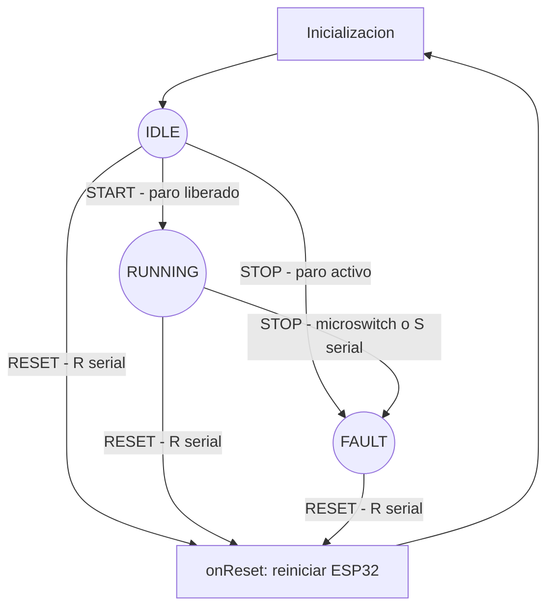

# Banda transportadora

## Alcance y organizacion

Firmware para IdeaBoard con ESP32 original Xtensa LX6, CPU fijada a 160 MHz.
`main.cpp` integra eventos, ISR y acciones. `fsm_control.cpp` contiene la matriz
constexpr; su cabecera declara los tipos y la interfaz. La HAL configura LEDC y
controla el motor. `hardware_pines.json` documenta las conexiones; no se carga en
ejecucion. No se crean tareas de usuario adicionales.

## FSM por eventos



IDLE es la espera inicial con motor frenado; RUNNING aplica PWM; FAULT mantiene
el freno hasta RESET. Soltar el microswitch no rearma ni genera START.
START se produce una sola vez tras setup. Si el paro esta activo, STOP tiene
prioridad. RESET es un reinicio completo, no un simple rearme de la FSM.
El destino IDLE de RESET en la matriz es nominal: onReset reinicia y no retorna.

| Estado | NONE | START | STOP | RESET |
|---|---|---|---|---|
| IDLE | IDLE / onNoop | RUNNING / onStart | FAULT / onFault | IDLE / onReset |
| RUNNING | RUNNING / onNoop | RUNNING / onNoop | FAULT / onFault | IDLE / onReset |
| FAULT | FAULT / onNoop | FAULT / onNoop | FAULT / onNoop | IDLE / onReset |

Cada celda contiene estado siguiente y puntero a funcion. El despacho hace un
acceso directo O(1); las acciones no se ejecutan dentro del spinlock.
Se verifica nuevamente el nivel del paro antes de aplicar PWM; si esta activo,
se despacha STOP. La lectura del pin no cambia el estado por si sola.

## Hilos, interrupciones y sincronizacion

Arduino ejecuta setup y loop dentro de su tarea loopTask, bajo FreeRTOS.
Se conserva su prioridad predeterminada; no se crean ni fijan nuevas tareas.
Las tareas internas del framework son independientes de los estados de la FSM.
La ISR no es un hilo. Se instala desde setup y atiende FALLING en IO33.

La ISR solo lee CCOUNT, filtra, activa stopPending e incrementa pressCount.
Ambos contextos usan el mismo portMUX_TYPE y sus variantes de seccion critica.
stopPending, lastCycle, haveLastCycle y el contador uint64_t son volatile;
volatile no sustituye el bloqueo. El contador no se lee fuera de la ISR en esta
version; toda futura lectura debe copiarlo bajo el mismo spinlock para evitar
lecturas fragmentadas. Eventos STOP repetidos se fusionan intencionalmente en
una bandera; para emergencia basta preservar al menos uno.

loop consume primero STOP, despues RESET pendiente y finalmente START.
STOP tambien puede solicitarse mediante S o s por serial. Se despacha por la
misma matriz y ejecuta onFault; no reinicia el ESP32 ni sustituye el microswitch.
Permanece en FAULT hasta RESET, incluso despues de soltar el paro fisico.
Solo se lee un caracter serial por vuelta para mantener trabajo acotado.
No se usa delay ni impresion serial en la ISR. RESET es una operacion terminal
de reinicio; no representa una accion ordinaria de tiempo constante.

## Antirrebote y reloj

25 ms * 160000000 ciclos/s = 4000000 ciclos. Se usa XTHAL_GET_CCOUNT y resta
uint32_t modular. El primer flanco siempre se acepta. CCOUNT vuelve a cero cada
26.8435456 s a 160 MHz. La resta representa el intervalo mientras sea menor que
una vuelta completa, no para tiempos arbitrariamente largos. loop desarma la
ventana de filtrado al superar 25 ms, evitando rechazos tras largas inactividades
durante funcionamiento normal. No se soportan cambios dinamicos de reloj ni
sleep; si se introducen, hay que revisar esta estrategia.

## PWM y parada

LEDC_TIMER_0, 1000 Hz, 10 bits; canales 0 y 1 en IO12 e IO14. Duty inicial
512/1023, aproximadamente 50 %, pendiente de ajuste con la carga real.
motorStop usa ledc_stop con nivel HIGH en ambas entradas para freno dinamico.
motorPWM limita a 1023 y establece la entrada B baja antes de aplicar PWM a A.
El sentido fisico depende de la polaridad de conexion del motor.

La interfaz obligatoria acordada tiene motorInicial, motorPWM y motorStop.
Retroceso y coast no se agregan silenciosamente a esta FSM de tres estados.
El enunciado original tambien solicita coast: queda pendiente confirmar la tabla
de verdad del chip instalado y acordar una ampliacion de la interfaz. Distintas
hojas L9110S muestran parada con ambas salidas bajas; no es correcto prometer
rueda libre solo por poner ambas entradas LOW. No afirmar cumplimiento de coast
hasta verificarlo con el hardware y el profesor.

## Validacion fisica pendiente

1. Encender con paro liberado: avance tras inicializar.
2. Pulsar paro: freno y FAULT; soltar no debe arrancar.
3. Enviar R: reinicio completo y nuevo arranque si el paro esta liberado.
4. Reiniciar con paro presionado: permanece en FAULT, sin impulso de motor.
5. Repetir pulsaciones y comprobar rebote, corriente, temperatura y brownouts.
6. Verificar frecuencia/duty con osciloscopio y frenado con carga segura.
7. Enviar S o s durante RUNNING: frena y permanece en FAULT. Enviar R o r:
   reinicia y vuelve a arrancar solo si el microswitch esta liberado.

El paro es gestionado por firmware: no corta fisicamente la alimentacion ni
constituye un circuito de seguridad certificado. Una accion puede retrasarse
hasta que loop atienda el evento; no se ha medido su latencia maxima.

## Referencias

- Enunciado Proyecto 1 proporcionado por el curso y estructura de clase.
- https://www.crcibernetica.com/crcibernetica-ideaboard/
- https://docs.espressif.com/projects/esp-idf/en/v4.4.8/esp32/api-reference/peripherals/ledc.html
- https://www.laskakit.cz/user/related_files/l9110s.pdf

## Investigación: análisis y comprensión

**Autor:** Jose Francisco Rodriguez Vasquez.

**Curso:** Programación II, Ingeniería Electrónica.
**Proyecto:** Firmware controlador de banda transportadora.

Las siguientes respuestas relacionan las preguntas del enunciado con la
implementación del repositorio. Se distingue entre el comportamiento diseñado,
la compilación confirmada y las pruebas físicas aún pendientes.

### 1. Contexto de tarea frente a contexto de interrupción

Una tarea dispone de pila y contexto administrados por el planificador. Puede
ceder la CPU o bloquearse esperando un recurso. Una ISR atiende una excepción
del procesador, interrumpiendo el flujo normal; debe terminar para devolver el
control. No es una tarea que pueda quedar esperando un tick.

`vTaskDelay()` bloquea a la tarea llamante y solicita planificación; usarlo en
una ISR viola las restricciones de esa API. Puede activar una aserción, provocar
un fallo o dejar un comportamiento inválido, según configuración: no es una
operación permitida ni una espera segura. En `stopISR()` no se usan retardos,
lecturas seriales ni control del motor; solo se registra la solicitud de paro.
Las API del kernel usadas en interrupciones deben admitir explícitamente ese
contexto, respetando además las prioridades de interrupción permitidas. [1, 2]

### 2. Mutex de tarea frente a spinlock SMP

Un mutex identifica una tarea propietaria y puede bloquear a otra tarea que
intente adquirirlo. Un spinlock utiliza una adquisición atómica y espera activa:
el núcleo que no consigue el bloqueo continúa intentando adquirirlo.

En ESP-IDF, las secciones críticas combinan el spinlock con el enmascaramiento
local de interrupciones pertinentes. Desactivar interrupciones únicamente en un
núcleo no impide que el otro acceda a la memoria compartida. Se necesita que
ambos participantes respeten el mismo mecanismo de exclusión.

`eventMux`, de tipo `portMUX_TYPE`, protege la bandera y los datos del antirrebote.
La ISR usa `portENTER_CRITICAL_ISR` y el bucle `portENTER_CRITICAL`, con sus
salidas correspondientes. Las regiones son breves y no llaman a la HAL. Un mutex
de tarea no puede reemplazarlas dentro de la ISR. Esto no significa que un
spinlock sea la única solución posible en todo diseño: también existen API de
colas y notificaciones para ISR; es la solución requerida en este proyecto. [1]

### 3. Inversión y herencia de prioridad

La inversión de prioridad ocurre cuando una tarea de alta prioridad espera un
recurso retenido por una de baja prioridad, mientras tareas de prioridad media
retrasan a la propietaria. La tarea alta queda indirectamente retrasada por las
medias, aunque debería tener preferencia sobre ellas.

Con herencia de prioridad, la propietaria del mutex recibe temporalmente una
prioridad elevada al bloquear a una tarea de mayor prioridad. Puede terminar su
sección protegida y liberar el recurso sin ser desplazada por esas tareas
intermedias. FreeRTOS implementa un mecanismo simplificado; no elimina las
esperas por recursos ni resuelve todos los casos de anidamiento o deadlock.
El firmware usa un spinlock, no un mutex: no atribuye herencia de prioridad a
`eventMux`. [3]

### 4. Condiciones de Coffman y deadlock entre tarea e ISR

Las cuatro condiciones son: exclusión mutua, retención mientras se espera,
ausencia de apropiación forzosa y espera circular. En el modelo clásico, deben
coexistir para que pueda aparecer un deadlock.

Un escenario incorrecto sería: la tarea toma un mutex; una ISR interrumpe esa
tarea e intenta esperar el mismo mutex; la tarea no puede reanudarse hasta que
termine la ISR; la ISR no terminaría hasta que la tarea liberase el mutex. Se
forma una dependencia circular entre el recurso y la devolución del control.
En FreeRTOS la operación ya es inválida por usar un mutex desde ISR: puede fallar
por aserción antes de materializar esa espera hipotética. No se debe presentar
este ejemplo como una secuencia válida de llamadas del kernel. En el proyecto,
el mismo spinlock y las secciones críticas apropiadas evitan ese patrón. [1, 3]

### 5. Caché de flash e IRAM_ATTR

El código almacenado en flash externa se ejecuta mediante la caché. Durante
ciertas operaciones de borrado o escritura de flash, necesarias por ejemplo
para NVS u OTA, esa caché puede quedar temporalmente deshabilitada. Una ISR que
intente ejecutar instrucciones de flash en ese intervalo no puede depender de
que estén accesibles.

`IRAM_ATTR` coloca el cuerpo de `stopISR()` en RAM de instrucciones. La seguridad
requiere además que sus funciones llamadas sean compatibles y los datos estén
en memoria interna accesible. El atributo por sí solo no garantiza seguridad:
también importa cómo se registra la interrupción. Las interrupciones no
registradas como IRAM-safe se difieren o deshabilitan durante estas operaciones;
no toda ISR sin el atributo falla inevitablemente. Debe auditarse la ruta completa
antes de incorporar NVS u OTA al firmware. [2]

### 6. Lecturas fragmentadas de 64 bits

Los registros generales del Xtensa LX6 son de 32 bits; no se debe suponer que
una lectura C++ de `uint64_t` es indivisible. Puede necesitar cargar por separado
las mitades baja y alta. La cantidad exacta de instrucciones depende del código
generado; lo esencial es que no hay garantía de lectura atómica de 64 bits.

Ejemplo: el contador cambia de `0x00000000FFFFFFFF` a `0x0000000100000000`.
Si la tarea obtiene la mitad baja antigua y luego la alta nueva, reconstruye
`0x00000001FFFFFFFF`, un valor que nunca tuvo el contador. Por eso una futura
consulta de `pressCount` debe copiarlo bajo `eventMux`. Actualmente solo la ISR
lo incrementa y el bucle no lo consulta. El bloqueo debe cubrir la lectura
completa, no cada mitad por separado.

### 7. volatile y optimización del compilador

Si el compilador no ve cambios válidos a una variable ordinaria, puede conservar
su valor en un registro o sacar una lectura fuera de un bucle. Por ejemplo,
podría reevaluar una copia antigua en lugar de acceder nuevamente al objeto.
El registro elegido no tiene por qué ser `a2`, y esta optimización no es exclusiva
de `-O2`.

En este entorno embebido, `volatile` exige realizar los accesos observables al
objeto según las reglas del compilador. No convierte `contador++` en una operación
atómica, no protege una lectura de 64 bits y no constituye una barrera general
para otros datos. Las variables compartidas del proyecto combinan `volatile`
con exclusión mediante `eventMux`; no se presenta `volatile` como sincronización
suficiente entre hilos C++. [4]

### 8. Física del rebote mecánico

Al cerrar el microswitch, los contactos chocan y se deforman elásticamente;
vibraciones, rugosidad y condiciones superficiales pueden producir aperturas y
cierres sucesivos antes de estabilizarse. La entrada digital detecta esos cambios
como flancos separados, aunque la persona haya hecho una sola pulsación.

A 160 MHz un ciclo dura 6.25 ns, mucho menos que un rebote mecánico habitual.
Las ráfagas de 20 a 50 cambios que menciona el enunciado son un ejemplo, no una
cantidad universal: dependen del interruptor y del circuito. El proyecto acepta
un primer flanco y filtra otros durante una ventana de 25 ms. Esa ventana debe
verificarse con el microswitch real; no demuestra por sí sola que el contacto
esté estabilizado. [5]

### 9. Filtrado mediante CCOUNT

`delay()` introduce una espera incompatible con una ISR breve. `millis()` no es
por definición una espera bloqueante, pero su resolución y su implementación
deben evaluarse; no satisface el mecanismo por ciclos que exige el enunciado.
No es riguroso afirmar que cualquier lectura de `millis()` falla en toda ISR.

`XTHAL_GET_CCOUNT()` permite obtener el contador de ciclos del núcleo sin esperar
a que transcurra el intervalo. Leer un registro mediante una instrucción no
significa que toda la ISR, la macro o el acceso protegido dure exactamente un
ciclo. El algoritmo compara marcas de tiempo y retorna inmediatamente.

Para la CPU configurada a 160 MHz:

```text
25 ms = 0.025 s
umbral = 160000000 ciclos/s * 0.025 s = 4000000 ciclos
```

El contador es propio de cada núcleo. Las marcas deben tomarse en el mismo
núcleo; la afinidad de loopTask y la instalación del servicio de interrupciones
deben comprobarse si se cambia la configuración. No se debe migrar la lógica a
otro núcleo ni cambiar el reloj sin revisar estas hipótesis. [6]

### 10. Demostración de la resta modular y su límite

Sea `M = 2^32`, la marca anterior `L` y un intervalo real `d`, con `0 <= d < M`.
La nueva marca es `C = (L + d) mod M`. La resta sin signo da:

```text
(C - L) mod M = ((L + d) - L) mod M = d mod M = d
```

Ejemplo atravesando cero:

```text
L = 0xFFFFFF00 = M - 256
C = 0x00000100 = 256
(C - L) mod M = 512 ciclos
```

A 160 MHz, `M / 160000000 = 26.8435456 s`. Si transcurren una o más vueltas
completas adicionales, el resultado solo conserva el residuo; no recupera ese
tiempo perdido. Por eso la corrección exige un intervalo menor que una vuelta,
frecuencia conocida y continuidad del contador. El bucle desactiva la ventana
al superar el umbral durante operación normal; no garantiza esa hipótesis si
deja de ejecutarse durante más de una vuelta. Esta demostración es algebraica.

### 11. Temporizador y canales PWM de hardware

El temporizador define la base de tiempo y resolución que utilizan los canales.
Se configura antes de asociar cada canal con ese temporizador y su GPIO, para
que la señal nazca con parámetros definidos. A 1000 Hz, el período es 1 ms.
La resolución de 10 bits divide ese período en 1024 pasos; el firmware limita
su interfaz a 0-1023 y utiliza inicialmente 512, aproximadamente 50 %.

En `motorInicial()`, `LEDC_TIMER_0` alimenta los canales 0 y 1, conectados a IO12
e IO14. LEDC mantiene la señal sin alternar manualmente el pin desde `loop()`.
`motorPWM()` establece el duty; `motorStop()` detiene los canales fijando ambas
entradas HIGH para solicitar freno dinámico. Frecuencia y resolución deben ser
compatibles con el reloj del periférico. La respuesta mecánica y eléctrica sigue
pendiente de comprobación física. [7]

### 12. Pull-up en IO33 frente a IO34

Con el contacto abierto, el pull-up de IO33 fija un nivel alto; al cerrarlo contra
GND aparece el flanco de bajada. IO34 es solo entrada y carece de pull-up y
pull-down internos configurables. `INPUT_PULLUP` no puede crear una resistencia
inexistente: sin polarización externa, el contacto abierto puede dejar la señal
flotante y generar lecturas o interrupciones erráticas.

Para trasladarlo a IO34 se necesitaría una resistencia externa a 3.3 V, con valor
elegido según ruido y consumo, además del cambio de pin en el firmware. El
circuito no necesariamente deja de funcionar por completo; pierde un nivel de
reposo fiable. La versión actual mantiene IO33. [8]

### 13. Matriz de transición y complejidad O(1)

El despacho obtiene `FSM[estado][evento]` mediante índices, sin recorrer una lista
de estados. El número de accesos no aumenta con la cantidad de filas o columnas:
la selección es O(1), mientras el almacenamiento de una matriz completa es O(S*E).
Cada celda contiene `nextState` y el puntero `action`; `COUNT` dimensiona la tabla
y no es un estado o evento operativo.

Esta representación facilita revisar todas las combinaciones y evita cadenas
manuales de comparaciones. Sin embargo, no se puede asegurar que siempre supere
a `switch`: el compilador también puede generar tablas de salto. Tampoco la
complejidad asintótica demuestra una ventaja de predicción de bifurcaciones,
latencia exacta o tiempo máximo de respuesta; hay llamadas indirectas, caché y
acciones que deben medirse. `onReset()` reinicia el sistema y no se trata como
una acción ordinaria que retorna. [9]

## Síntesis del diseño y evidencia disponible

La arquitectura separa selección de comportamiento, acciones de aplicación y
acceso a periféricos. El microswitch produce STOP; la ISR lo registra y el bucle
lo consume antes que START. Soltar el paro mantiene FAULT. El comando serial R
genera RESET y `onReset()` reinicia el ESP32; no se confunde con un simple cambio
de variable de estado. Las acciones permanecen fuera de las secciones críticas.

La compilación en VS Code fue confirmada con SUCCESS, 22064 bytes de RAM y
278785 bytes de flash. Esto acredita generación del firmware, no las pruebas de
motor, corriente, antirrebote o latencia. El último registro de upload compartido
falló por ausencia de puerto detectado. No se inventan ensayos ni resultados.
La función coast solicitada originalmente sigue pendiente de resolver y validar;
el documento no atribuye esa capacidad al freno implementado.

## Fuentes del análisis

La numeración permite relacionar cada respuesta con su documentación técnica.
Las ecuaciones y ejemplos numéricos son desarrollos del análisis; los resultados
de compilación proceden del registro proporcionado por el estudiante.

1. [Espressif: FreeRTOS SMP y secciones críticas, ESP-IDF 4.4.8](https://docs.espressif.com/projects/esp-idf/en/v4.4.8/esp32/api-guides/freertos-smp.html).
2. [Espressif: asignación de interrupciones e IRAM-safe handlers](https://docs.espressif.com/projects/esp-idf/en/v4.4.8/esp32/api-reference/system/intr_alloc.html).
3. [FreeRTOS: mutexes y herencia de prioridad](https://freertos.org/Documentation/02-Kernel/02-Kernel-features/02-Queues-mutexes-and-semaphores/04-Mutexes).
4. [GCC: accesos volatile y límites de ordenamiento](https://gcc.gnu.org/onlinedocs/gcc/Volatiles.html).
5. [Texas Instruments: Debounce a Switch](https://www.ti.com/document-viewer/lit/html/scea094).
6. [Espressif: contador de ciclos del núcleo](https://docs.espressif.com/projects/esp-idf/en/v5.0/esp32/api-reference/system/misc_system_api.html). Referencia conceptual de la API; el firmware usa la macro Xtensa disponible en Arduino 2.0.17.
7. [Espressif: configuración de LEDC, ESP-IDF 4.4.8](https://docs.espressif.com/projects/esp-idf/en/v4.4.8/esp32/api-reference/peripherals/ledc.html).
8. [Espressif: restricciones de GPIO del ESP32](https://docs.espressif.com/projects/esp-idf/en/latest/esp32/api-reference/peripherals/gpio.html).
9. [GCC: generación de código y tablas de salto](https://gcc.gnu.org/onlinedocs/gcc/Code-Gen-Options.html).
