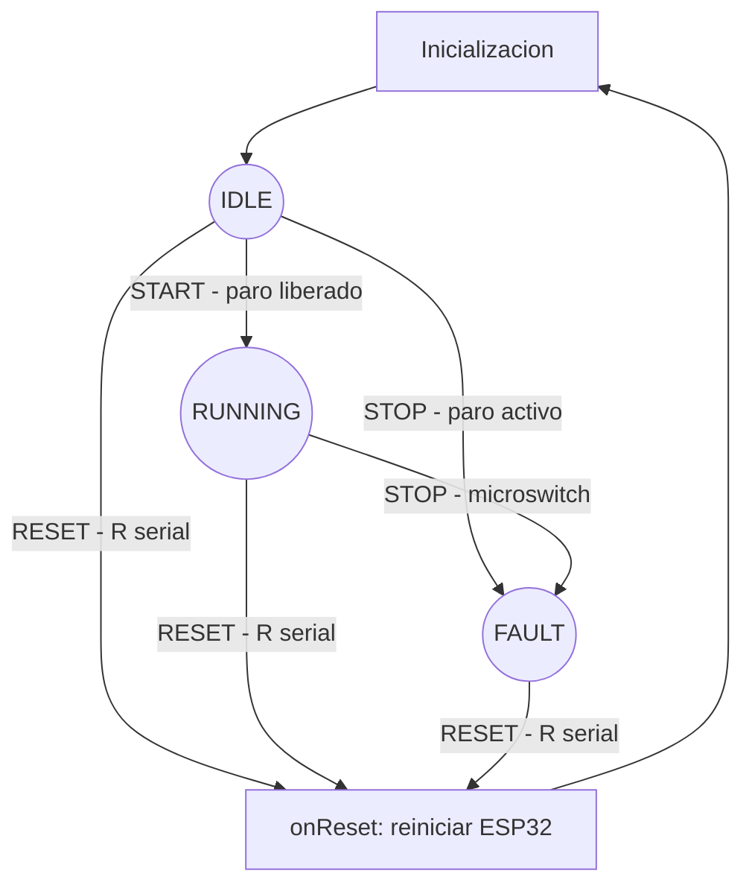

# Banda transportadora

## Alcance y organizacion

Firmware para IdeaBoard con ESP32 original Xtensa LX6, CPU fijada a 160 MHz.
`main.cpp` integra eventos, ISR y acciones. `fsm_control.cpp` contiene la matriz
constexpr; su cabecera declara los tipos y la interfaz. La HAL configura LEDC y
controla el motor. `hardware_pines.json` documenta las conexiones; no se carga en
ejecucion. No se crean tareas de usuario adicionales.

## FSM por eventos

IDLE es la espera inicial con motor frenado; RUNNING aplica PWM; FAULT mantiene
el freno hasta RESET. Soltar el microswitch no rearma ni genera START.
START se produce una sola vez tras setup. Si el paro esta activo, STOP tiene
prioridad. RESET es un reinicio completo, no un simple rearme de la FSM.
El destino IDLE de RESET en la matriz es nominal: onReset reinicia y no retorna.

| Estado | NONE | START | STOP | RESET |
|---|---|---|---|---|
| IDLE | IDLE / onNoop | RUNNING / onStart | FAULT / onFault | IDLE / onReset |
| RUNNING | RUNNING / onNoop | RUNNING / onNoop | FAULT / onFault | IDLE / onReset |
| FAULT | FAULT / onNoop | FAULT / onNoop | FAULT / onNoop | IDLE / onReset |

Cada celda contiene estado siguiente y puntero a funcion. El despacho hace un
acceso directo O(1); las acciones no se ejecutan dentro del spinlock.
Se verifica nuevamente el nivel del paro antes de aplicar PWM; si esta activo,
se despacha STOP. La lectura del pin no cambia el estado por si sola.

## Hilos, interrupciones y sincronizacion

Arduino ejecuta setup y loop dentro de su tarea loopTask, bajo FreeRTOS.
Se conserva su prioridad predeterminada; no se crean ni fijan nuevas tareas.
Las tareas internas del framework son independientes de los estados de la FSM.
La ISR no es un hilo. Se instala desde setup y atiende FALLING en IO33.

La ISR solo lee CCOUNT, filtra, activa stopPending e incrementa pressCount.
Ambos contextos usan el mismo portMUX_TYPE y sus variantes de seccion critica.
stopPending, lastCycle, haveLastCycle y el contador uint64_t son volatile;
volatile no sustituye el bloqueo. El contador no se lee fuera de la ISR en esta
version; toda futura lectura debe copiarlo bajo el mismo spinlock para evitar
lecturas fragmentadas. Eventos STOP repetidos se fusionan intencionalmente en
una bandera; para emergencia basta preservar al menos uno.

loop consume primero STOP, despues RESET pendiente y finalmente START.
Solo se lee un caracter serial por vuelta para mantener trabajo acotado.
No se usa delay ni impresion serial en la ISR. RESET es una operacion terminal
de reinicio; no representa una accion ordinaria de tiempo constante.

## Antirrebote y reloj

25 ms * 160000000 ciclos/s = 4000000 ciclos. Se usa XTHAL_GET_CCOUNT y resta
uint32_t modular. El primer flanco siempre se acepta. CCOUNT vuelve a cero cada
26.8435456 s a 160 MHz. La resta representa el intervalo mientras sea menor que
una vuelta completa, no para tiempos arbitrariamente largos. loop desarma la
ventana de filtrado al superar 25 ms, evitando rechazos tras largas inactividades
durante funcionamiento normal. No se soportan cambios dinamicos de reloj ni
sleep; si se introducen, hay que revisar esta estrategia.

## PWM y parada

LEDC_TIMER_0, 1000 Hz, 10 bits; canales 0 y 1 en IO12 e IO14. Duty inicial
512/1023, aproximadamente 50 %, pendiente de ajuste con la carga real.
motorStop usa ledc_stop con nivel HIGH en ambas entradas para freno dinamico.
motorPWM limita a 1023 y establece la entrada B baja antes de aplicar PWM a A.
El sentido fisico depende de la polaridad de conexion del motor.

La interfaz obligatoria acordada tiene motorInicial, motorPWM y motorStop.
Retroceso y coast no se agregan silenciosamente a esta FSM de tres estados.
El enunciado original tambien solicita coast: queda pendiente confirmar la tabla
de verdad del chip instalado y acordar una ampliacion de la interfaz. Distintas
hojas L9110S muestran parada con ambas salidas bajas; no es correcto prometer
rueda libre solo por poner ambas entradas LOW. No afirmar cumplimiento de coast
hasta verificarlo con el hardware y el profesor.

## Validacion fisica pendiente

1. Encender con paro liberado: avance tras inicializar.
2. Pulsar paro: freno y FAULT; soltar no debe arrancar.
3. Enviar R: reinicio completo y nuevo arranque si el paro esta liberado.
4. Reiniciar con paro presionado: permanece en FAULT, sin impulso de motor.
5. Repetir pulsaciones y comprobar rebote, corriente, temperatura y brownouts.
6. Verificar frecuencia/duty con osciloscopio y frenado con carga segura.

El paro es gestionado por firmware: no corta fisicamente la alimentacion ni
constituye un circuito de seguridad certificado. Una accion puede retrasarse
hasta que loop atienda el evento; no se ha medido su latencia maxima.

## Referencias

- Enunciado Proyecto 1 proporcionado por el curso y estructura de clase.
- https://www.crcibernetica.com/crcibernetica-ideaboard/
- https://docs.espressif.com/projects/esp-idf/en/v4.4.8/esp32/api-reference/peripherals/ledc.html
- https://www.laskakit.cz/user/related_files/l9110s.pdf

El cuestionario teorico completo del enunciado debe completarse antes de la entrega.
